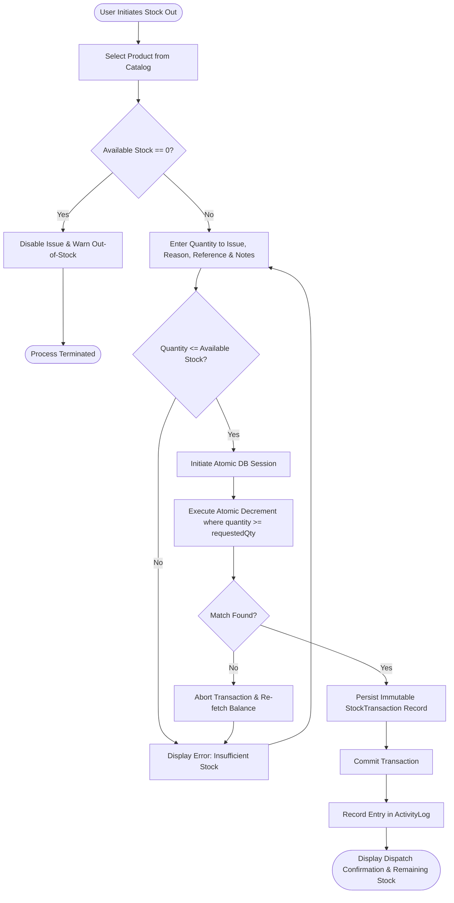
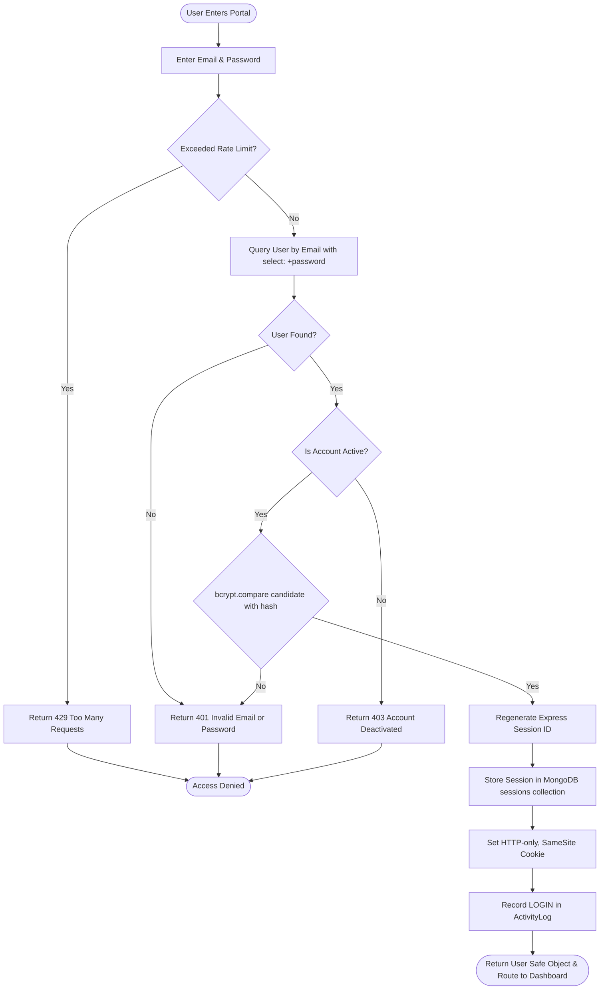

# UML Activity Diagrams

## 1. Stock-In Receiving Activity Flow

```mermaid
flowchart TD
    Start([User Initiates Stock In]) --> SelectProd[Select Product from Catalog]
    SelectProd --> ShowStock[System Displays Current Stock & Standard Cost]
    ShowStock --> InputDetails[Input Quantity, Unit Cost, Supplier, Reference & Notes]
    InputDetails --> ValidateInput{Valid Input? Quantity >= 1}
    ValidateInput -- No --> ShowValErr[Display Validation Error] --> InputDetails
    ValidateInput -- Yes --> StartTxn[Start Atomic DB Session]
    StartTxn --> UpdateProd[Execute $inc: { quantity: +qty } on Product]
    UpdateProd --> WriteLog[Persist Immutable StockTransaction Record]
    WriteLog --> CommitTxn[Commit Transaction]
    CommitTxn --> AuditEntry[Record Entry in ActivityLog]
    AuditEntry --> ShowSuccess([Display Success Certificate & New Balance])
```

---

## 2. Stock-Out Fulfillment Activity Flow



---

## 3. User Authentication Flow


