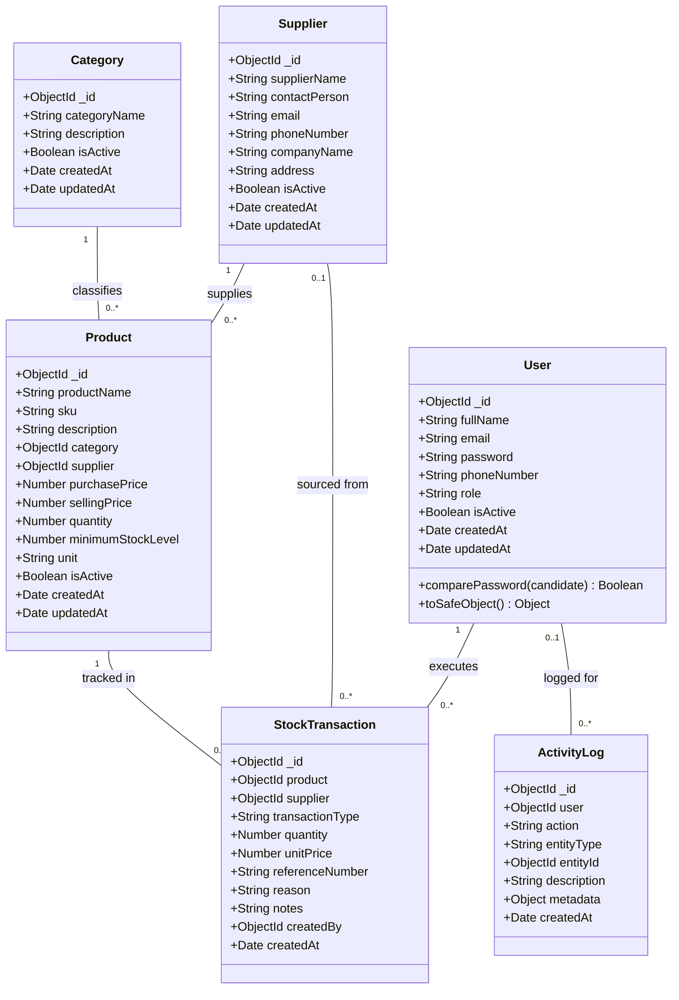

# UML Class Diagram (Data Models & Architecture)

### Entity Schema Dictionary

1. **User:** Represents system actors. Passwords are protected via bcrypt hashing with 12 salt rounds and excluded from standard projections via `{ select: false }`. Role is restricted to `admin` or `staff`.
2. **Category:** Hierarchical grouping of products. Case-insensitive unique indexing ensures no duplicates.
3. **Supplier:** Commercial vendor profiles associated with products and stock-in receipts.
4. **Product:** Master SKU catalog records. Holds unit pricing, current on-hand quantity, minimum stock safety thresholds, and unit of measure.
5. **StockTransaction:** Immutable event record written during stock-in receipts and stock-out issues. Preserves audit data indefinitely.
6. **ActivityLog:** Server-side security and administrative activity log recording logins, logouts, entity creations, updates, and permission changes.
