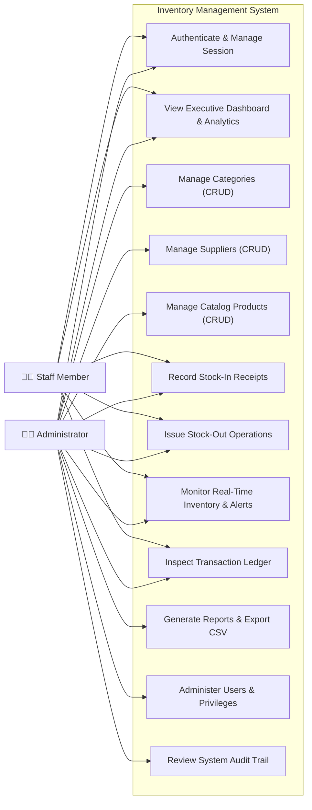

# UML Use Case Diagram

### Use Case Specifications

| ID | Use Case Name | Primary Actor | Description |
|---|---|---|---|
| **UC-01** | Authenticate & Manage Session | Staff, Admin | Secure session login, cookie management, session regeneration, and logout. |
| **UC-02** | Executive Dashboard | Staff, Admin | View high-level metrics, stock health percentages, and 7-day movement charts. |
| **UC-03** | Product Catalog CRUD | Admin (write), Staff (read) | Manage SKUs, pricing, classifications, and threshold configurations. |
| **UC-04** | Category & Supplier Management | Admin (write), Staff (read) | Organize products into taxonomies and maintain procurement vendor contact books. |
| **UC-05** | Stock-In Receipt | Staff, Admin | Receive merchandise from vendors, atomically increment inventory, write ledger transaction. |
| **UC-06** | Stock-Out Issue | Staff, Admin | Issue items for sales/internal use, prevent negative balance, write ledger transaction. |
| **UC-07** | Inventory & Stock Alerts | Staff, Admin | Real-time monitoring of available units with automatic Low-Stock and Out-of-Stock flags. |
| **UC-08** | Transaction Ledger Audit | Staff, Admin | Search, filter, and inspect immutable historical stock movements. |
| **UC-09** | Executive Reports & CSV | Admin, Staff | Filter and export Inventory Snapshots, Movement Reports, and Asset Valuation. |
| **UC-10** | User Management & Audit | Admin only | Provision user accounts, assign roles, toggle access, and review security activity logs. |
